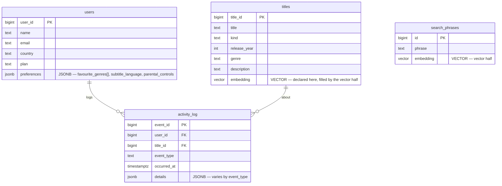

# Schema diagram

Renders on GitHub. For the submission, export this as a PDF/image (GitHub's rendered view,
mermaid.live, or redraw in draw.io). **JSONB** columns: `users.preferences`, `activity_log.details`.
**Vector** column: `titles.embedding` (added by the vector half).



## Example JSON documents

`users.preferences`:
```json
{ "favourite_genres": ["Mystery", "Thriller"], "subtitle_language": "es", "parental_controls": false }
```

`activity_log.details` (shape varies by `event_type`):
```json
{ "minutes_watched": 72, "device": "tv" }      // play
{ "stars": 4 }                                  // rate
{ "query": "scary woods", "results": 5 }        // search
{ "at_minute": 18 }                             // pause
```
